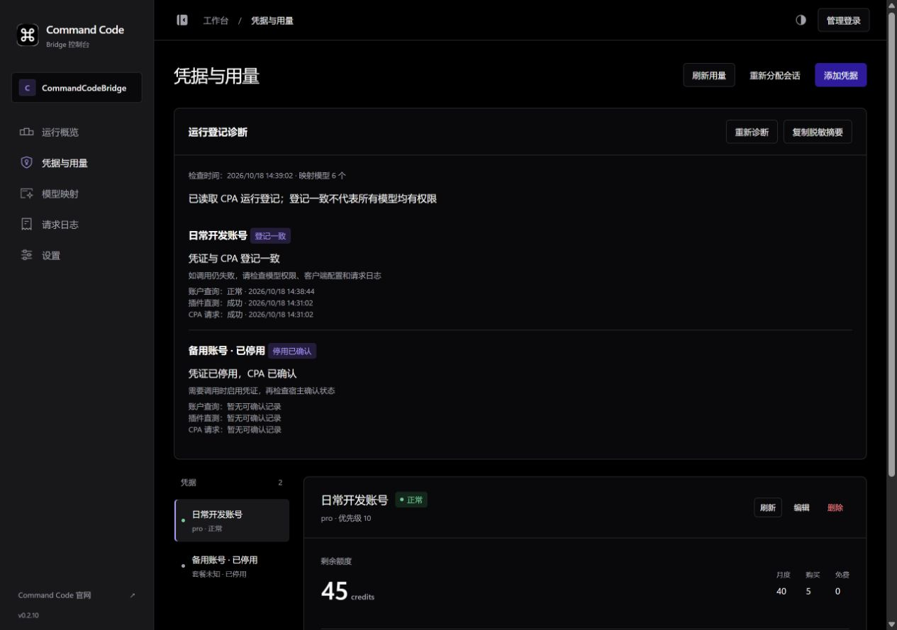
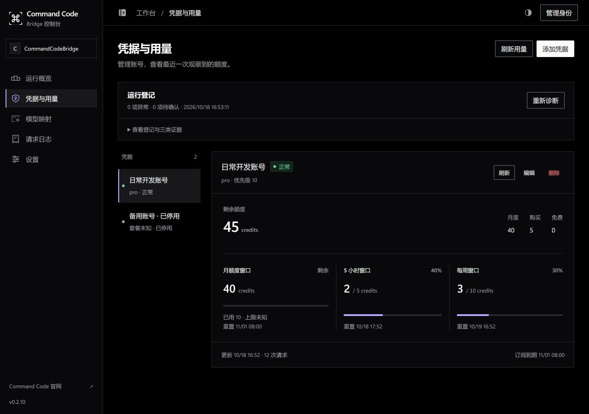
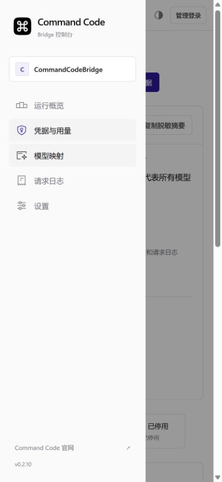
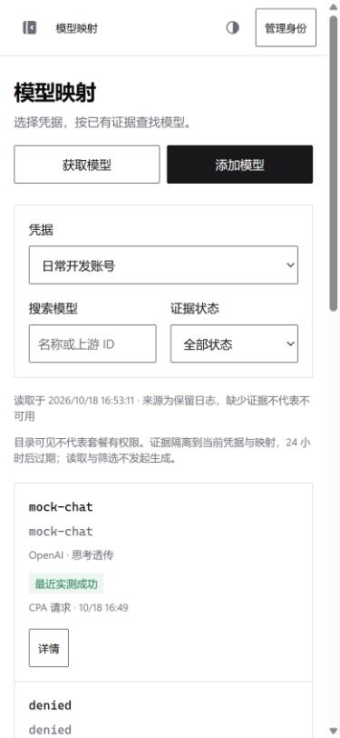
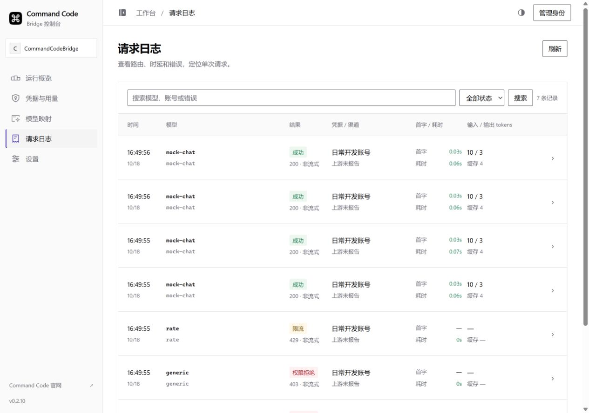
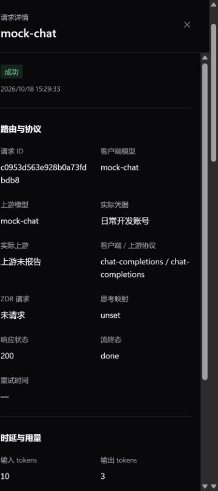

# 第三轮界面交付与视觉核对

日期：2026-10-18。v0.2.10 未发布源码，追加到 [PR #12](https://github.com/Gaoshou101/CommandCodeBridge/pull/12)。本轮完成五页及通用窗口的本地改造。设计约定见 [ROUND3_UI_PLAN.md](ROUND3_UI_PLAN.md)，验证汇总见 [VALIDATION.md](VALIDATION.md)。

## 官方参照与适配判断

参照来源均在本轮实际访问；官方公开截图的拍摄版本未知。当前 Studio 只能访问公开登录页，没有登录官方账号、生成 key 或调用真实模型。

| 项目 | 官方已核实依据 | 本轮实现与差异 |
| --- | --- | --- |
| 导航、页头与区域 | [概览](https://commandcode.ai/docs/command/studio-overview.jpg)：紧凑导航、横向指标、近直角区域 | 224px 导航／64px 收起，56px 桌面页头；保留 Bridge 五页与中文任务说明 |
| 浅色与按钮 | [当前登录页](https://commandcode.ai/studio)：白底、近黑主按钮、0px 圆角变量、14px 控件 | 中性主按钮，紫色用于选择／证据；区域近直角，控件 2px。次文字由参考的 `#71717a` 调为 `#6b6b74`，保证弱背景上的对比度 |
| 字体与字阶 | 登录页使用 Geist；公开截图无法精确测量字阶 | 不引入远程字体或未经许可的字体文件；使用系统回退，不声称实际加载了 Geist。24px 页面标题、15px 分组、14px 正文、12px 辅助信息 |
| 凭据与额度 | [key 页面](https://commandcode.ai/docs/command/api-key-section.webp)：页级说明与明确主操作 | 登记诊断折叠为异常／待确认／时间摘要，所选凭据与额度进入首屏；三来源证据仍独立展示 |
| 模型与列表 | [用量列表](https://commandcode.ai/docs/command/usage-list.webp)：摘要、列表与状态 | 模型工具栏合并凭据、搜索与状态；行内证据精简，来源、时间、过期与协议进入详情；手机使用精简列表 |
| 请求详情 | [详情](https://commandcode.ai/docs/command/usage-details.jpg)：右侧独立面板、分组字段 | 日志／模型共用 480px 抽屉；手机全宽，Esc／关闭返回原行；字段限于脱敏元数据 |
| 设置与手机 | 当前登录后设置、手机导航与暗色计算样式不可读取 | 请求策略、数据保留、CPAMP、兼容、存储分区；手机 44px 主要触达区属于 Bridge 适配，不作为官网测量值 |

本轮遵循公开概览／详情的视觉方向，未声称逐像素复刻当前登录后的 Studio。

## 精选前后对照

### 凭据与用量：1280px 深色

改造前：

改造后：

### 模型映射：390px 浅色

改造前：

改造后：

### 请求列表与手机详情

## 完整截图索引

共 **20 组／40 张**：五页 × 两种 CSS 视口 × 两种主题 × before／after。改造前基线 `c03c314`；改造后为本轮最终 UI 源码与动态库，SHA-256 记录于 [ROUND3_SCREENSHOTS.json](ROUND3_SCREENSHOTS.json)。截图使用同构的虚构场景，时间和请求 ID 不同。CSS 视口与工具实际返回的图像像素尺寸分别记录，不能互相替代。

完整图像位于本机忽略目录，六张精选随仓库提交。完整路径模式为：

`dist/round3/{before|after}/{1280|390}-{light|dark}-{view}.jpg`

| 页面 | view | 1280×900 浅色 | 1280×900 深色 | 390×844 浅色 | 390×844 深色 |
| --- | --- | --- | --- | --- | --- |
| 运行概览 | overview | before／after | before／after | before／after | before／after |
| 凭据与用量 | credentials | before／after | before／after | before／after | before／after |
| 模型映射 | models | before／after | before／after | before／after | before／after |
| 请求日志 | logs | before／after | before／after | before／after | before／after |
| 设置 | settings | before／after | before／after | before／after | before／after |

复现入口：设置 `CPA_BINARY`、`BRIDGE_LIBRARY` 后运行 `python tests/console_preview.py --ready-file dist/round3/preview.json --scenario normal`。脚本仅启动 loopback 上游和隔离 CPA，凭据均为虚构；Enter 结束。另有 `empty`、`single`、`dense`、`recovery` 场景；构建动态库须包含当前内嵌页面。

## 状态、键盘与可读性

| 项目 | 结果与证据范围 |
| --- | --- |
| 正常五页、明暗主题 | 20 个最终 after 视图的根 `scrollWidth == clientWidth`，无整页横向溢出；完整数值表仅局部滚动 |
| 375px／1440px | 导航 Esc、模型无结果／清除、日志详情、设置高级路径及主布局已检查 |
| 等效 200% 重排 | 640×450 CSS 视口下五页无溢出；浏览器没有可用 zoom 能力，快捷键未改变实际缩放，因此**真实浏览器 200% zoom 待验证** |
| 抽屉与窗口 | Tab／Shift+Tab 循环、Esc、关闭回原行、嵌套模型编辑取消返回通过；列表刷新或手机布局切换时寻找可见替代按钮 |
| 认证 | 最终动态库退出后日志、详情、目录与测试输出立即清空；重新登录恢复。延迟目录／测试／日志响应和较晚身份响应由 Node 测试覆盖 |
| 空数据与操作 | 0 凭据／0 模型／0 请求、单凭据、添加、目录导入、模拟直测、统计过期确认取消通过；取消未删除数据 |
| 密集与长内容 | 20 凭据／100 长模型名筛选通过；8400 字符错误转义，未生成 script 节点，抽屉及根页面无溢出 |
| 旧数据与恢复 | 两天前额度保留原时间并显示失败，未知 cap 不画比例；过期证据带来源／时间；实际损坏统计主文件后显示检查点恢复和历史缺口 |
| 待写状态 | 待写文件、开始时间、最后成功与恢复文件转义由 Node 渲染用例覆盖；未宣称注入了浏览器持续写入失败 |
| 对比度 | 根据本轮 CSS 变量计算：普通正文组合最低 4.80:1，状态正文最低 4.93:1，必要控件边界最低 4.12:1；装饰分隔线不视为控件。减少动态效果规则已保留 |
| 浏览器运行错误 | 本机插件及 CPAMP 联测读取的 console errors 为 0；不包括人为输入错误密钥得到的预期 HTTP 拒绝 |

状态截图在 `dist/round3/states/`：`375-model-no-result.jpg`、`375-log-drawer-dark.jpg`、`390-empty-logs.jpg`、`390-dense-filter.jpg`、`390-stale-usage.jpg`、`390-long-error.jpg`、`cpamp-native-quota.jpg`、`cpamp-embedded.jpg`、`cpamp-embedded-mobile.jpg`。状态图在交互修复期间采集；完整 after 二十张及 CPAMP 手机图已由最终源码重采。

## CPAMP 回归范围

本轮未修改 `integrations/cpamp/` 或原生面板资源。使用 `dbf61ddf438f399558722df3467355c42af9005d` 的实际 Windows Manager Server 和已有内嵌面板，代理隔离 CPA 8.0.23：原生账号额度卡片、停用状态、最近请求、CommandCode 授权入口与五页 iframe 可用。仅查看授权入口，没有启动官网授权。

390px 下另核对 iframe 内模型导航；宿主根宽度 390／390px、iframe 根宽度 375／375px，无横向溢出。未改变宿主自己的导航、主题或额度组件。

在本夹具中，未勾记住凭证的宿主登录没有自动传入 iframe；单独输入虚构 CPAMP 管理密钥并选择 Bearer 后通过。原先“CPAMP 管理密钥”与 `X-Management-Key` 的错误对应已改为协议名称，保留两种头的兼容支持。未改认证存储规则或增加跨源传递密钥。

## 自动化与后续边界

Node **31/31**；Windows Go 1.26 的项目测试／vet；Windows amd64 动态库编译；实际 CPA 的 `cpa_diagnostics.py` 与 `cpa_round2.py` 均通过。协议套件使用本机模拟端，包括有上限的 13 次 Chat／Responses／Messages、工具、图片传输、thinking 重放和 ZDR 头，真实生成请求数为 **0**。未重新运行未变更的 CPAMP 前端生产构建／组件套件，不将宿主联测冒充该构建门槛。

真实 Claude、图片语义、thinking 权限与签名、ZDR 服务端策略、身份共享继续待验证。实际 200% zoom 与当前登录后官网参照仍需补证据。本轮核对完成时为 v0.2.10 未发布源码；后续已获用户合并／发版授权，实际发布状态见 [Release](https://github.com/Gaoshou101/CommandCodeBridge/releases/tag/v0.2.10)。本次不部署目标服务。
